# BROKEN SOVEREIGN — 클래스 다이어그램

- 대상: 프로토타입 범위 (GDD 11장). 신격 이후 격·각성·초월·태초 클래스 제외
- 기준 문서: `Docs/GDD.md` 12장 기술 설계 방향, `Docs/Rules/FolderRules.md`, `Docs/Rules/NamingRules.md`
- 표기: 필드·메서드는 핵심만 기재. 세부 시그니처는 구현 단계 확정
- 문서 상태: 초안 v0.4 (능력치 시스템·치명타·대상 선택 구현 반영). "확인 필요" 표시 항목은 미결정
- 구현 상태 표기: 각 장 상단 "구현 상태" 줄, 다이어그램의 `예정`·`임시` 표기

## 1. 설계 원칙

| 원칙 (GDD 12장) | 클래스 구조 적용 |
|---|---|
| 데이터 중심 | 기술·영웅의 길·신물·장비·적·격 단계·시련·밸런스 수치를 `~Definition` ScriptableObject로 정의 |
| 규칙 분리 | 영웅 고유 메커니즘·격 수확 패턴은 이벤트를 구독하는 규칙 객체(`HeroRule`, `HarvestPattern`). 전투 코드에 영웅별 분기 없음 |
| 순수 계산 | 피해·돌파 조건·신앙·스탯·기술 빌드 계산은 MonoBehaviour 밖 순수 클래스. EditMode 테스트 대상 |
| 이벤트 연결 | 전투 → 성장 시스템은 `EventBus` 이벤트로만 연결. 예외: 시전 전 수치 변경은 `ISkillParameterModifier` (6.1) |

### 클래스 종류 표기

| 표기 | 의미 |
|---|---|
| `<<MonoBehaviour>>` | 게임 오브젝트에 붙는 컴포넌트 |
| `<<ScriptableObject>>` | `Assets/Data/` 에셋으로 만드는 정의 데이터 |
| `<<pure>>` | MonoBehaviour·ScriptableObject를 상속하지 않는 순수 C# 클래스 |
| `<<struct>>` | 값 형식 (이벤트, 계산 입력·결과) |
| `<<abstract>>` / `<<interface>>` / `<<enum>>` / `<<static>>` | C# 의미 그대로 |
| `<<Serializable>>` | MonoBehaviour 필드로 Inspector에 노출되는 일반 C# 클래스 |
| `예정` / `임시` | 미구현 설계 / 디버그용으로 추후 제거 |

## 2. 폴더 간 의존 관계

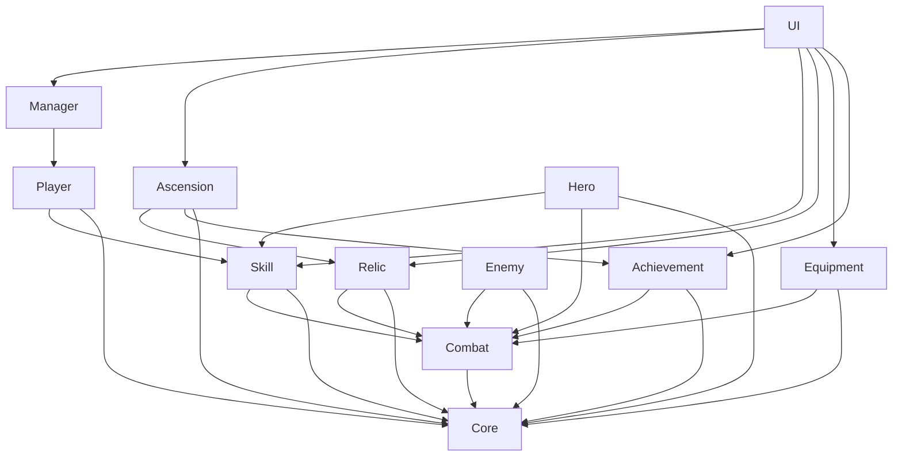

- 화살표 방향: 참조하는 쪽 → 참조되는 쪽
- 역방향 참조 금지. 하위 폴더(Combat 등)가 상위 폴더(Skill·Hero 등)에 알려야 할 일은 이벤트 발행으로 처리
- UI는 읽기 전용 참조. 게임 상태 변경은 각 시스템의 공개 메서드 호출로만 처리

## 3. Core

이벤트 버스, 공용 enum, 스탯 수정치

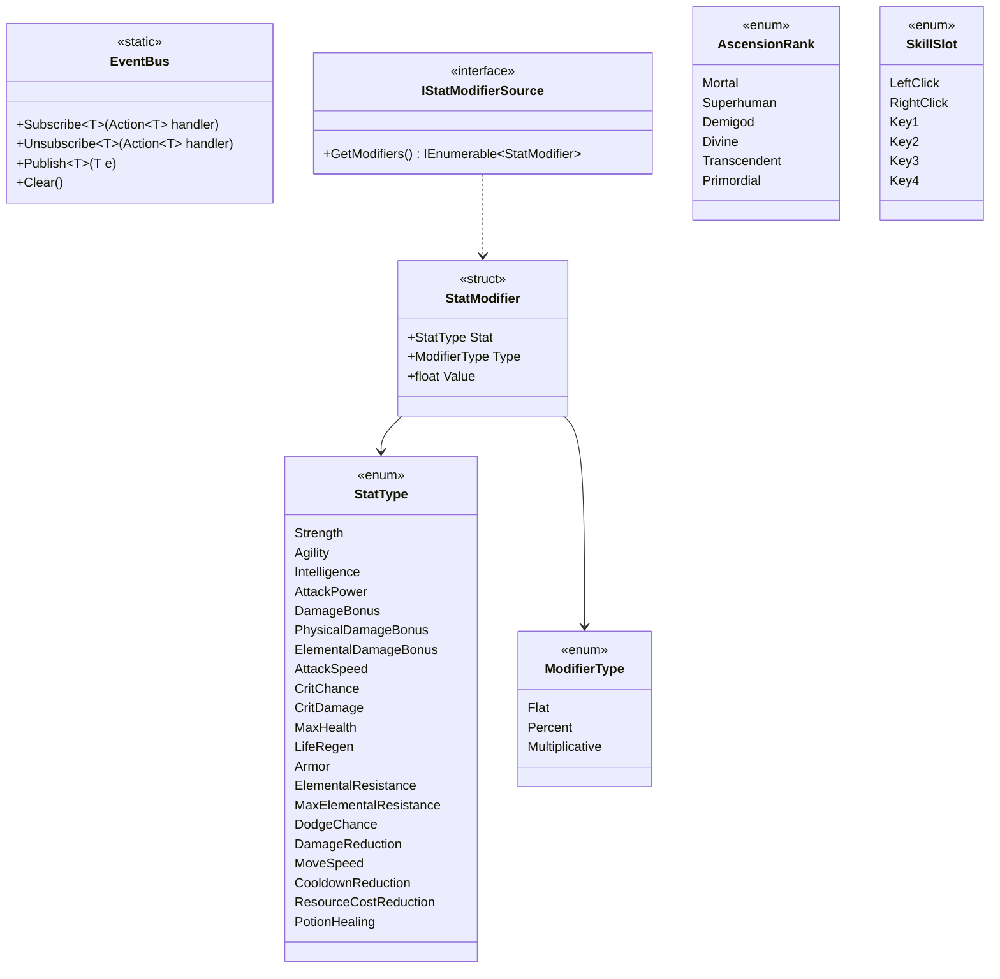

- `AscensionRank` 값과 격 대응: Mortal 범인 / Superhuman 초인 / Demigod 반신 / Divine 신격 / Transcendent 초월 / Primordial 태초
- `SkillSlot`: 프로토타입은 4번 키까지. 5·6번은 본 기획 단계 추가
- 구현 상태: `StatType`, `ModifierType`, `StatModifier`, `IStatModifierSource`, `SkillSlot` 구현 완료 (2026-10-13)
- `StatType` 구분: 1차 스탯(힘·민첩·지능) / 공격 / 방어 / 유틸. 비율 능력치는 소수로 저장 (0.05 = 5%)
- `ModifierType` 합산 순서: (기본값 + Flat 합) × (1 + Percent 합) × Multiplicative 곱
- 이벤트 구조체 목록: 13장 참고

## 4. Player

클릭 이동, 입력, 교전(대상 추적·자동 공격), 회피, 물약, 쿼터뷰 카메라

- 구현 상태: 구현 완료 (2026-10-08), 대상 선택 추가 (2026-10-13). `SkillCaster` 연결만 예정

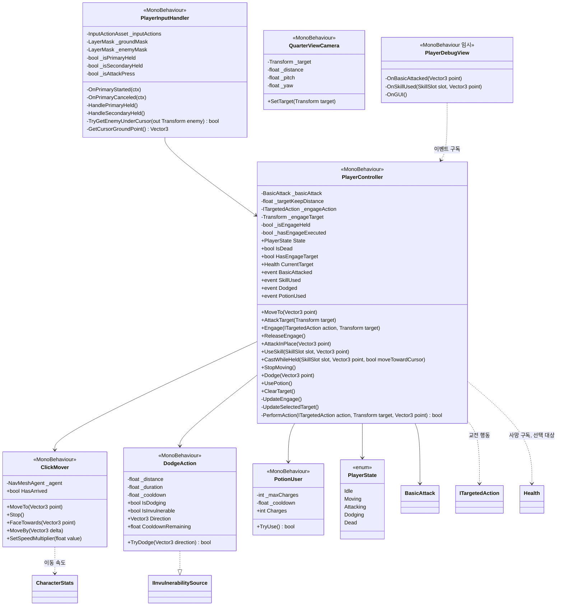

- 이동: `NavMeshAgent` 기반 클릭 이동 (AI Navigation 패키지)
- 교전(engage): 공격 대상과 행동(`ITargetedAction`)을 `PlayerController`가 보관. 매 프레임 사거리 밖이면 추적, 사거리 안이면 자동 실행 (14.3)
  - 짧은 클릭: 1회 실행 후 해제 / 누르고 있음: 반복 실행
  - 해제 조건: 바닥 이동, 제자리 공격, 우클릭 시전, 회피, 대상 소멸·사망
  - 1~4 기술 시전은 교전 유지 (이동 중 시전 원칙)
- 우클릭 유지: 커서 방향 이동 + 일정 간격 반복 시전. 유지형 범위 기술(휠윈드 등)도 같은 경로
- 대상 선택(`CurrentTarget`): 교전 시작 시 대상의 `Health` 보관. 교전과 별개로 유지 (원 테두리·상단 체력 게이지 표시용, 12.1)
  - 교체: 다른 적 클릭
  - 해제: 대상 사망·비활성화, `_targetKeepDistance`(기본 20m) 이탈, 플레이어 사망
  - 유지: 바닥 클릭 이동 (이동 중 대상 체력 확인 목적)
- 회피·사망 중에는 모든 행동 입력 무시 (`IsActionLocked`)
- 기본 공격 경로: 현재 `PlayerController` → `BasicAttack` 직접 실행. `SkillCaster` 구현 시 LeftClick 슬롯 통합 방식은 15장 9번
- 이동 중 시전 원칙(GDD 6.1): `Casting` 상태(예정)에서도 `ClickMover` 이동 유지, 경직 0.3초 이하
- `PlayerDebugView`: 기본 도형 플레이어용 임시 시각화. 애니메이션·이펙트 적용 시 제거

## 5. Combat

체력, 피해 계산, 대상 지정 행동, 범위 판정, 무적, 상태이상, 스탯 합산, 전투 상태 판정

- 구현 상태: `IDamageable`, `Health`, `DamageInfo`, `DamageRequest`, `DamageCalculator`, `IInvulnerabilitySource`, `ITargetedAction`, `BasicAttack`, `AttackArea`(부채꼴) 구현 완료 (2026-10-08). `StatSheet`, `StatFormula`, `CharacterStats`, `CharacterStatsData`, `DamageType`, 치명타 구현 완료 (2026-10-13). 나머지는 예정

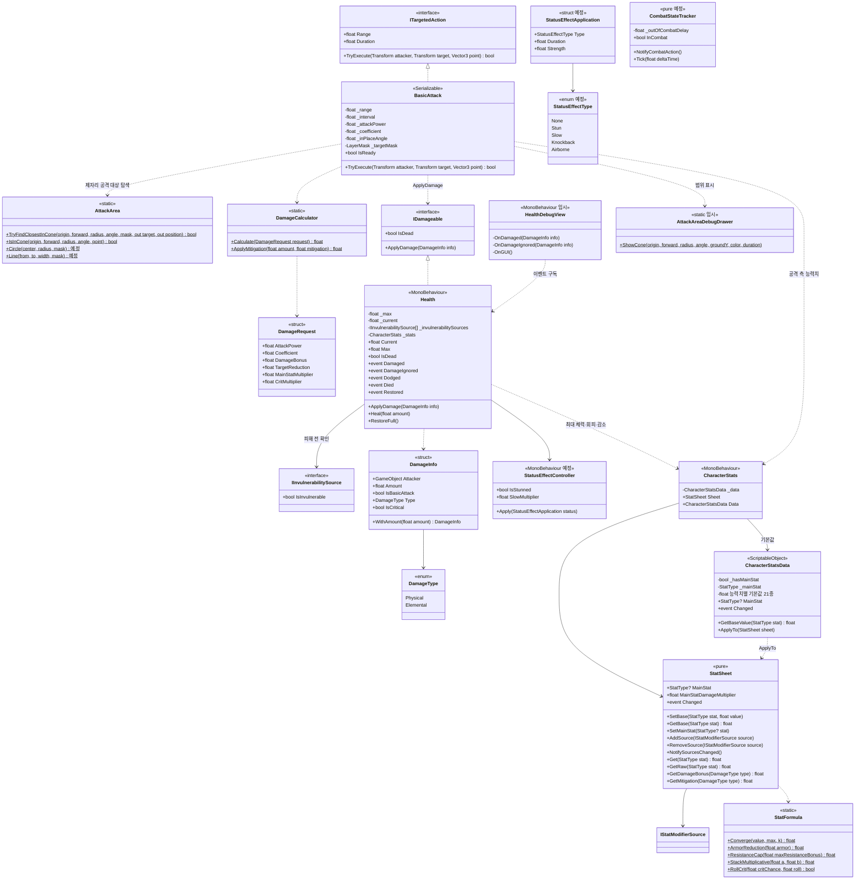

- 피해 계산 (공격 측, `DamageCalculator.Calculate`): 피해량 = 공격력 × 계수 × (1 + 피해 증가) × 주 스탯 배율 × 치명타 배율. 피해 증가 하한 −100%, 결과 0 이상
  - 피해 증가 = 모든 피해 증가 + 타입별(물리·원소) 피해 증가
  - 주 스탯 배율 = 1 + 주 스탯 × 0.001 (무직은 1)
  - 치명타 배율 = 1 + 치명타 피해 (치명타 발생 시, 기본 +50%)
- 받는 피해 (방어 측, `Health.ApplyDamage`): 무적 확인 → 회피 판정(`Dodged`) → 감소 적용(`ApplyMitigation`) → `Damaged`(최종 값)
  - 감소 = 타입별 감소(물리: 방어력, 원소: 원소 저항)와 피해 감소를 곱셈 쌓기. 1 − (1 − a)(1 − b)
  - `CharacterStats`가 없는 대상은 감소 없이 그대로 적용
- 능력치 구조
  - `CharacterStatsData`: 캐릭터별 기본값 에셋 (`Data/Balance/PlayerBaseStats`). 적은 같은 항목·다른 수치의 에셋을 따로 만들어 연결
  - `CharacterStats`: 에셋 기본값으로 `StatSheet` 구성. Play 중 에셋 수정 즉시 반영. 디버그 버프 메뉴(임시)
  - `StatSheet`: 기본값 + 출처(`IStatModifierSource`: 버프·장비·신물) 합산. 버프는 개체별 `StatSheet`에만 적용, 에셋 값 불변
- 1차 스탯 변환 (`StatFormula`, 디아블로4 방식 상한)

| 1차 스탯 | 효과 | 계산 |
|---|---|---|
| 힘 | 방어력 | 1당 +1. 감소율 = 방어력 / (방어력 + 1000), 상한 85% |
| 민첩 | 공격 속도 | 수렴식 0.5 × 민첩 / (민첩 + 1000), 최대 +50% |
| 지능 | 원소 저항 | 수렴식 0.5 × 지능 / (지능 + 1000), 최대 +50%. 저항 상한 70% (+ 상한 증가, 최대 85%) |
| 주 스탯 | 피해 | 1당 +0.1% |

- 기타 상한: 치명타 확률 0~1, 피해 감소·재사용 대기 감소는 곱셈 쌓기
- 공격 속도 적용: 공격 간격 = 기본 간격 / (1 + 공격 속도)
- 회피 무적: `Health`가 같은 오브젝트의 `IInvulnerabilitySource`를 수집해 피해 전 확인. `DodgeAction`이 구현하며 회피 지속 시간(0.2초) 전체 무적 (GDD 6.1). Combat이 Player를 참조하지 않는 의존 방향 유지. 무적 버프(불굴의 갑주 등)도 같은 인터페이스로 확장
- `ITargetedAction`: 대상에게 접근 후 사거리 안에서 실행하는 행동. 원거리 기본 공격·대상 지정 기술이 구현하면 `PlayerController.Engage`의 추적 흐름 재사용. 지점 지정·유지형 범위 기술은 대상이 없으므로 기술 시전 경로 사용
- `BasicAttack`: 단일 대상. 대상 지정 시 해당 대상, 제자리 공격 시 전방 부채꼴(90°) 안의 가장 가까운 적. 빗나가도 실행으로 처리(공격 간격 소모)
- `DamageInfo` 확장 예정: `SkillId`, `IsEmpowered`(신앙 충만), `Status`(상태이상)
- 이벤트 연결: 현재 `Health`의 C# 이벤트 사용. 신앙 자원 구현 시 `EventBus` 발행 추가 (플레이어 → `PlayerDamagedEvent`, 적 → `DamageDealtEvent`, 사망 시 `EnemyKilledEvent`)
- `CombatStateTracker`: 신앙 비전투 감소(GDD 6.3) 판정용. `_outOfCombatDelay` 값은 GDD 확정 필요 항목 (밸런스 에셋에서 주입)
- `AttackArea`: 원형·부채꼴·직선 범위 판정 공용 유틸리티. 기술·적 공격이 공유. 현재 부채꼴만 구현
- 임시 수치 (테스트용): 플레이어 체력 500·공격력 100·이동 속도 6·치명타 5%/+50%·힘·민첩·지능 각 10 (`PlayerBaseStats`), 적 체력 100 (`Health` 필드), 기본 공격 계수 1, 사거리 2, 공격 간격 0.6초
- `HealthDebugView`·`AttackAreaDebugDrawer`: 임시 디버그 표시 (체력 막대, 피해 숫자, 피격 깜빡임, 빨간 공격 범위). HUD·이펙트 구현 시 제거
  - 피해 숫자: 일반 흰색 `100`, 치명타 노란색 1.5배 `150!`, 회피 "회피", 무적 "무적"

## 6. Skill

### 6.1 정의와 실행

기술 정의는 데이터, 기술 동작은 전략 객체(`SkillBehaviour`)로 분리

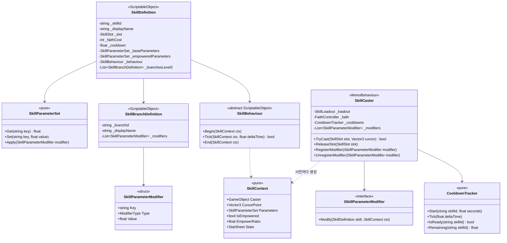

- 시전 순서: 슬롯의 장착 기술 조회 → 재사용 대기·신앙 확인 → 기본 수치 + 선택 분기 수정치 적용 → `ISkillParameterModifier` 적용(영웅 규칙 등) → 충만이면 충만 수치 적용 → `SkillBehaviour.Begin`
- 지속 시전 기술(난천무): `Tick`이 `false`를 돌려주거나 키를 떼면(`ReleaseSlot`) `End` 호출
- `ISkillParameterModifier`: 시전 전에 수치를 바꿔야 하는 규칙(석천 여의) 전용 연결 지점. 이벤트는 사후 통지라 시전 전 개입 불가. GDD 12장 '이벤트 연결' 원칙의 유일한 예외
- `SkillCastEvent` 발행 시점: `Begin` 직후

### 6.2 SkillBehaviour 파생 클래스

| 클래스 | 사용 기술 (에셋) | 주요 파라미터 키 |
|---|---|---|
| `ComboMeleeBehaviour` | 맹세의 타격 (`SkillOathStrike`) | 타수, 타별 계수, 마지막 타 범위 |
| `ConeSmashBehaviour` | 격광 강타 (`SkillRadiantSmite`), 공용 기술 잔향 강타 (`SkillResonantStrike`) | 계수, 반경, 각도, 파동 거리 |
| `ReturningThrowBehaviour` | 잔광 투척 (`SkillAfterglowThrow`) | 계수, 사거리, 착탄 반경 |
| `DashStrikeBehaviour` | 진격의 맹세 (`SkillAdvancingOath`) | 계수, 거리, 기절 시간 |
| `LeapSlamBehaviour` | 도약 강하 (`SkillLeapingDescent`) | 계수, 사거리, 착지 반경, 둔화 시간 |
| `TimedBuffBehaviour` | 불굴의 갑주 (`SkillUnyieldingAegis`), 보복의 맹세 (`SkillOathOfRetribution`) | 지속 시간, 피해 감소율, 신앙 충전 배율, 피해 저장 비율 |
| `ExpandingShockwaveBehaviour` | 격진 (`SkillSovereignQuake`) | 파동 수, 반경 증가량, 띄우기 시간 |
| `ExecuteStrikeBehaviour` | 분쇄 일격 (`SkillCrushingStrike`) | 기본 계수, 처형 계수, 처형 충격파 반경·계수, 충만 시 게이지 감소율 |
| `ChannelSpinBehaviour` | 난천무 (`SkillSkyRampage`) | 타격 간격, 계수, 반경, 이동 속도 배율, 초당 소모 |

- 행동 9종으로 기술 10개 처리. 불굴의 갑주·보복의 맹세는 `TimedBuffBehaviour` 공유, 파라미터로 방어형·반격형 구분
- 기술 에셋 영어 이름: 제안 (확인 필요 15장 6번)
- 충만 강화 효과: `_empoweredParameters`로 수치 변경. 빛기둥 추가 같은 동작 추가는 파생 클래스에서 `ctx.IsEmpowered` 분기

### 6.3 기술 빌드와 신앙

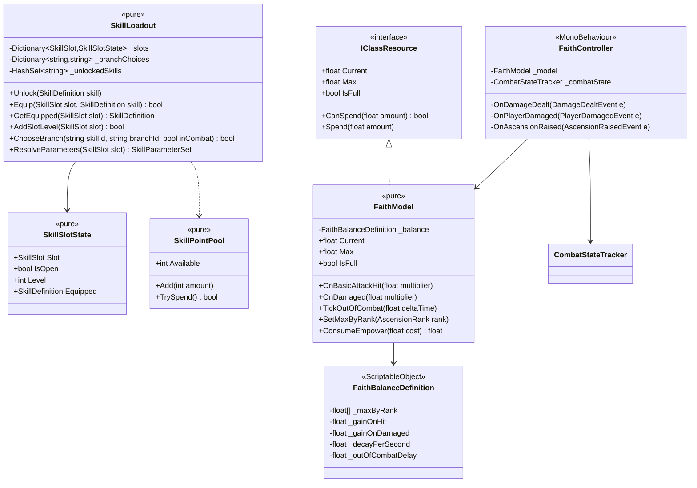

- 슬롯 레벨: 슬롯 단위 저장. 기술 교체 후에도 유지 (GDD 5.4)
- 무직 상태: 우클릭 슬롯만 개방, 공용 기술 `SkillResonantStrike` 장착. `JobSelectedEvent` 수신 시 우클릭을 1차 직업 기본 기술로 교체, 1·2번 슬롯 개방 (GDD 6.6)
- 무직 상태 자원: `FaithController` 비활성. 직업 선택 시 해당 직업의 `IClassResource` 활성
- 분기 선택: `_branchChoices`에 기술 ID별 저장. 비전투일 때만 변경 가능 (`inCombat` 검사)
- 프로토타입 분기 대상: 우클릭 슬롯만. 분기 목록이 비어 있는 기술은 레벨만 상승
- 충만 강화량: `ConsumeEmpower(cost)`가 `cost / Max` 비율 반환 → `SkillContext.EmpowerRatio`. 반환 후 신앙 전량 소모
- 불굴의 갑주 '피격 시 신앙 충전 2배': `FaithModel.OnDamaged(multiplier)`의 배율 인자로 처리
- `IClassResource`: 무사 투기·궁사 집중·마법사 마나 확장 대비. 프로토타입 구현체는 `FaithModel` 하나

## 7. Ascension

레벨, 스탯 분배, 격 단계, 돌파 조건

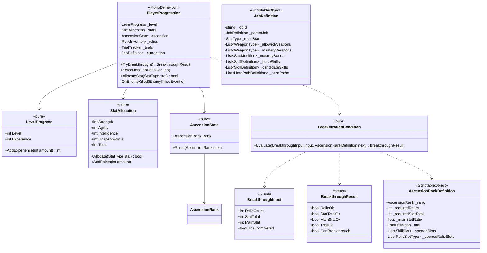

- 주 스탯 기준: `ceil(필요 스탯 총합 × _mainStatRatio)`. 비율 0.4 (GDD 3.1)
- `BreakthroughResult`: 조건별 충족 여부를 따로 보관. 캐릭터 창 진행도 표시에 그대로 사용
- 돌파 성공 시 `AscensionRaisedEvent` 발행 → 신앙 최대치, 기술 슬롯, 신물 칸 개방이 각각 구독
- 레벨업 시 스탯 3포인트(`StatAllocation`)와 스킬 포인트 1(`SkillPointPool`) 동시 지급. `PlayerLeveledUpEvent` 발행
- `JobDefinition`: 1차 직업(성기사)·2차 직업(성투사)을 같은 클래스로 표현, `_parentJob`으로 연결. `Scripts/Ascension/`·`Data/Ascension/` 배치
- 직업 선택: 시작 시 `_currentJob` = null (무직). 구역 1 직업 선택 이벤트에서 `SelectJob` 호출 → `JobSelectedEvent` 발행 (GDD 4.1)
- 프로토타입 직업 선택 화면: 4개 직업 표시, 성기사만 선택 가능. 잠금 여부는 `JobDefinition`의 `_isSelectable` 값으로 제어 (제안)

## 8. Hero

영웅의 길 정의, 영웅 고유 메커니즘 규칙 객체, 성물 기술 변형

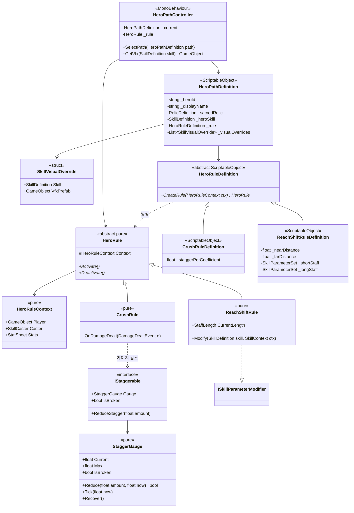

- 규칙 객체 수명: `SelectPath`에서 `CreateRule` → `Activate`(이벤트 구독·등록), 사망·씬 종료 시 `Deactivate`(해제)
- 야로미르(분쇄): `CrushRule`이 `DamageDealtEvent`를 구독해 대상 `IStaggerable`의 버팀 게이지를 계수 × 10만큼 감소. 0이 되면 적이 무력화(기존 `IStunnable.Stun` + 받는 피해 증가 수정치)하고 `EnemyStaggeredEvent` 발행. 분쇄 일격은 `ExecuteStrikeBehaviour`가 `IsBroken`이면 처형 수치 적용
- `StaggerGauge`는 순수 클래스 (게이지 감소·회복 대기·무력화 후 저항 시간). 영웅 미선택 시에도 적 컴포넌트에 존재하며 감소 주체만 영웅 규칙
- 석천(사거리 전환): 좌클릭 시전 직전 대상 거리로 봉 길이 결정 → `ISkillParameterModifier`로 좌클릭 수치 교체
- 성물 기술 변형: `_visualOverrides`로 이펙트 프리팹만 교체 (영웅 2명 × 기술 3개 = 6개). `SkillBehaviour`는 `HeroPathController.GetVfx` 결과 사용
- 무력화 알림(금이 간 방패 표시): `EnemyStaggeredEvent` 발행 → UI 구독
- 클래스 이름은 영웅 이름이 아닌 메커니즘 이름 사용 (영웅 이름·칭호 변경에 영향받지 않도록)

## 9. Relic · Equipment

### 9.1 Relic

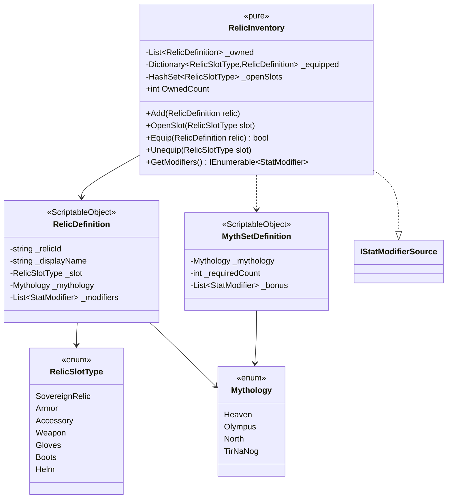

- 돌파 조건의 신물 수: `OwnedCount`(보유 기준). 장착 수 아님 (GDD 5.1 '칸 수 < 보유 수' 구조)
- 무기 칸(`Weapon`): 반신 돌파 시 개방, 선택한 영웅의 성물만 장착 가능
- 신화 세트: 장착 신물 중 같은 `Mythology` 수가 `_requiredCount` 이상이면 `_bonus` 적용. 프로토타입은 천계 2세트 1개
- 군주의 유물(`SovereignRelic`): 칸만 정의, 프로토타입 효과 없음 (확인 필요 15장 5번)

### 9.2 Equipment

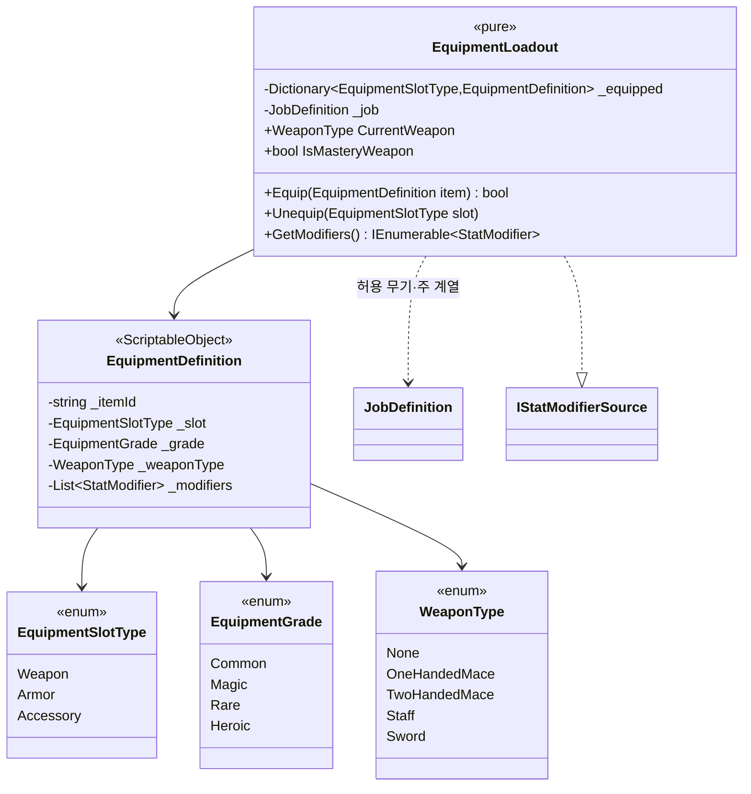

- 장착 제한: 1차 직업 `_allowedWeapons` 검사. 무직(`_job` = null) 시 규칙은 GDD 확정 필요 항목. 주 계열 보너스: 현재 2차 직업 `_masteryWeapons`에 포함 시 `_masteryBonus` 추가
- 무기 교체 시 `WeaponChangedEvent` 발행 → 애니메이터 기본 공격 모션 교체 (한손 둔기 ↔ 양손 둔기)
- 프로토타입 부위: 무기·갑옷·장신구 3칸. 본 기획 7칸은 enum 값 추가로 확장

## 10. Achievement

시련 판정과 보상 지급

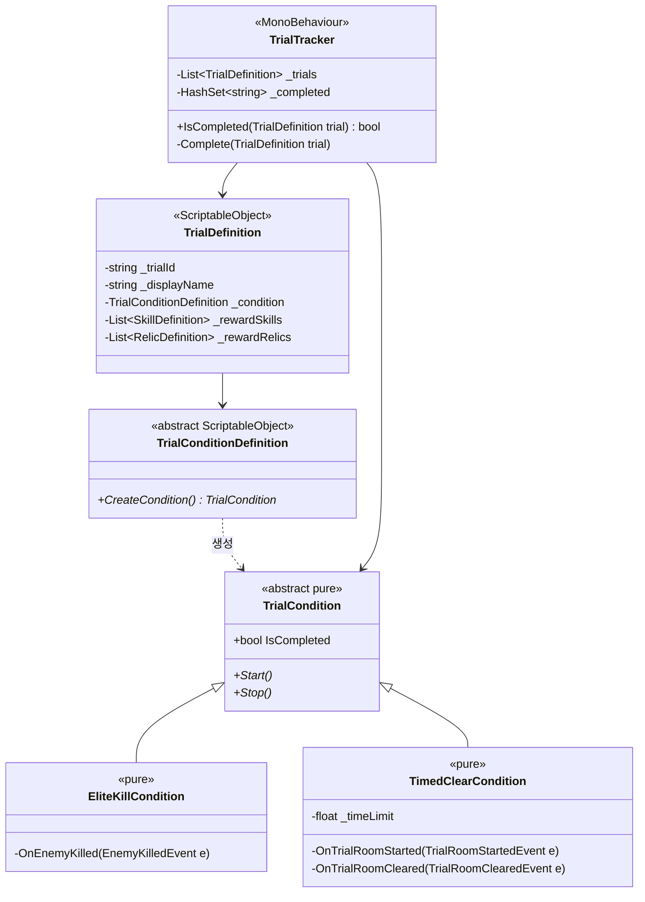

- 범인 시련: `EliteKillCondition` (천계 정예 처치). 초인 시련: `TimedClearCondition` (시련 방 제한 시간 섬멸)
- 시련 완료 시 `TrialCompletedEvent` 발행 → 보상 기술은 `SkillLoadout.Unlock`, 보상 신물은 `RelicInventory.Add` (`SkillUnlockedEvent`, `RelicAcquiredEvent` 연쇄 발행)
- 일반 업적(스탯 보너스)·특수 업적(칭호): 프로토타입 제외. 같은 조건 구조로 확장

## 11. Enemy

### 11.1 일반·정예 적

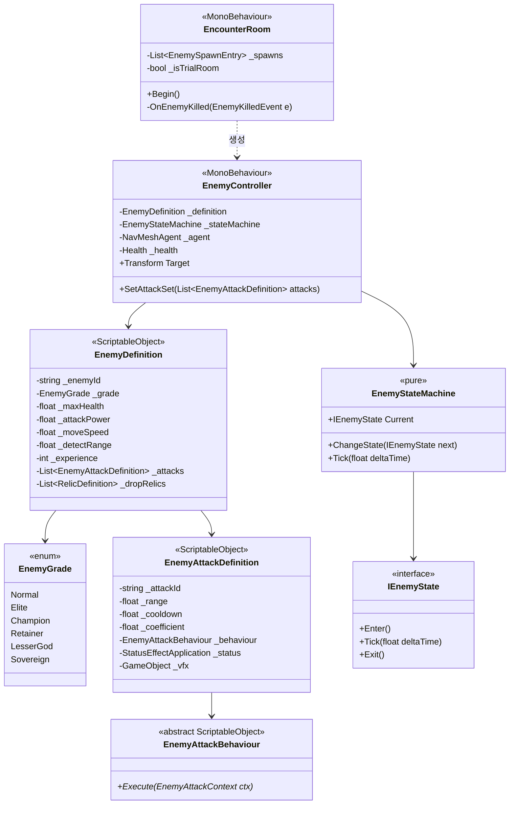

- 상태: `IdleState`, `ChaseState`, `AttackState`, `DeadState` (모두 `IEnemyState` 구현). 정예·보스도 같은 상태 머신 사용
- 적 공격 동작: 기술과 같은 전략 객체 구조(`EnemyAttackBehaviour`). 근접 휘두르기·돌진·광선 등 파생 클래스
- `EncounterRoom`: 방 진입 시 적 생성, 전멸 시 출구 개방. 시련 방이면 `TrialRoomStartedEvent`·`TrialRoomClearedEvent` 발행
- `EnemyGrade` 값과 등급 대응: Retainer 권속 / LesserGod 하위 신 / Sovereign 주신. 챔피언·주신은 프로토타입 미사용
- 현재 구현 (2026-10-08): 테스트용 `DummyEnemy` (큐브 모형 + `Health` + `HealthDebugView` + `TestDummyRespawner`). `TestDummyRespawner`는 사망 시 모형·충돌체를 숨기고 3초 뒤 체력 회복 후 재등장하는 임시 컴포넌트. `EnemyController` 구현 시 제거

### 11.2 보스: 우사·풍백, 이랑진군

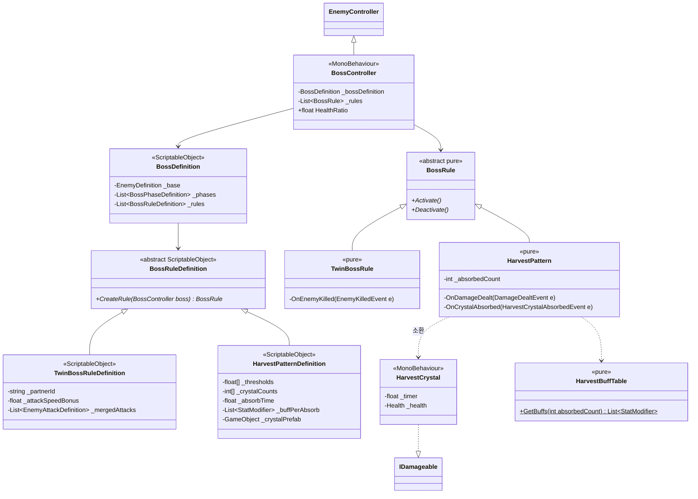

- 우사·풍백: AI·패턴은 같은 `EnemyDefinition` 공유. 공격 이펙트·효과만 각자의 `EnemyAttackDefinition` 에셋으로 분리 (우사: 비·감속 / 풍백: 바람·넉백)
- `TwinBossRule`: 상대(`_partnerId`) 사망 이벤트 수신 시 공격 속도 증가 + `_mergedAttacks`로 공격 세트 교체 (`SetAttackSet`). GDD 7.3 '데이터 교체' 방식
- 이랑진군: 삼첨양인도 연속 베기·효천견 돌진·제3의 눈 광선을 `EnemyAttackDefinition` 3개로 정의 + `HarvestPattern` 규칙
- 격 수확: 체력 75·50·25% 도달 시 결정 소환 → 10초 내 미파괴 결정은 흡수 → 흡수 수 기준 누적 강화 (`HarvestBuffTable`)
- 결정 흡수 강화의 보호막(최대 체력 20%): `Health`에 보호막 값 추가 필요 (확인 필요 15장 4번)

## 12. UI · Manager

### 12.1 UI

| 클래스 | 화면 | 구독 이벤트·참조 |
|---|---|---|
| `HudView` | HUD 전체 묶음 (코드로 생성, 구현 완료) | `PlayerController`, `Health`, `IResourceGauge` |
| `TargetFrameView` | 화면 상단 가운데 선택 대상 이름·체력 막대·남은 비율(%) (구현 완료) | `PlayerController.CurrentTarget`, `Health` |
| `TargetRingView` | 선택 대상 발밑 흰색 원 테두리 (LineRenderer, 구현 완료) | `PlayerController.CurrentTarget` |
| `HealthBarView` | 체력 | `PlayerDamagedEvent`, `Health` |
| `FaithBarView` | 신앙, 충만 표시 | `FaithChangedEvent` |
| `SkillSlotView` | 기술 슬롯·재사용 대기 | `SkillCastEvent`, `CooldownTracker` |
| `CharacterWindow` | 격 단계, 스탯 분배, 돌파 진행도 | `PlayerProgression`, `BreakthroughResult` |
| `RelicWindow` | 신물창, 신화 세트 | `RelicInventory` |
| `EquipmentWindow` | 장비창 | `EquipmentLoadout` |
| `SkillWindow` | 후보 기술 장착, 슬롯 레벨, 분기 선택 | `SkillLoadout`, `SkillPointPool` |
| `TrialWindow` | 시련 목록·진행 | `TrialTracker` |
| `NoticeView` | 돌파·해금·무력화 알림 | `AscensionRaisedEvent`, `SkillUnlockedEvent`, `EnemyStaggeredEvent` |
| `JobSelectView` | 1차 직업 선택 화면 (4개 카드, 프로토타입은 성기사만 활성) | `PlayerProgression`, `JobDefinition` |
| `HeroPathSelectView` | 영웅의 길 선택 연출 | `HeroPathController` |
| `BossHealthView` | 보스 체력 | `BossController` |

- UI는 화면 표시와 버튼 입력만 담당. 규칙 판정은 각 시스템 클래스에서 처리
- 대상 표시 설정: `HudView`의 `TargetSettings` (원 색·두께·여백, 게이지 크기·색·위쪽 여백). Play 중 Inspector 변경 즉시 반영
- `BossHealthView`: 구현 시 `TargetFrameView`와 위치 겹침. 보스전 중 대상 게이지 숨김 여부 확인 필요

### 12.2 Manager

| 클래스 | 종류 | 역할 |
|---|---|---|
| `GameStateManager` | MonoBehaviour | 게임 상태(`Playing`, `Paused`, `PlayerDead`, `Victory`) 전환, 일시정지 |
| `CheckpointManager` | MonoBehaviour | 마지막 방 입구 기록, 사망 시 부활 위치 지정 |
| `ZoneFlowManager` | MonoBehaviour | 구역 1~3·보스 방 진행, 문 개방 |
| `PlayerRegistry` | static | 플레이어 참조 제공 (적 AI·UI용) |

- 저장·불러오기: 프로토타입 제외. 체크포인트는 실행 중 메모리에만 유지 (확인 필요 15장 7번)

## 13. 이벤트 목록

`Scripts/Core/Events/` 폴더 배치. 모두 `struct`

| 이벤트 | 발행 | 주요 구독 | 데이터 |
|---|---|---|---|
| `DamageDealtEvent` | `Health` (적) | `FaithController`, `CrushRule`, `HarvestPattern` | 공격자, 대상, 피해량, 기술 ID, 기본 공격 여부, 충만 여부 |
| `PlayerDamagedEvent` | `Health` (플레이어) | `FaithController`, `HealthBarView` | 피해량, 공격자 |
| `PlayerDiedEvent` | `Health` (플레이어) | `GameStateManager`, `CheckpointManager` | - |
| `EnemyKilledEvent` | `Health` (적) | `PlayerProgression`, `TrialCondition`, `TwinBossRule`, `EncounterRoom` | 적 ID, 등급, 경험치, 처치 기술 ID |
| `SkillCastEvent` | `SkillCaster` | `SkillSlotView`, `CombatStateTracker` | 기술 ID, 슬롯, 충만 여부, 소모 신앙 |
| `FaithChangedEvent` | `FaithController` | `FaithBarView` | 현재값, 최대치, 충만 여부 |
| `PlayerLeveledUpEvent` | `PlayerProgression` | `SkillPointPool`, `NoticeView` | 새 레벨 |
| `AscensionRaisedEvent` | `PlayerProgression` | `FaithController`, `SkillLoadout`, `RelicInventory`, `NoticeView` | 새 격 |
| `TrialCompletedEvent` | `TrialTracker` | `PlayerProgression`, `NoticeView` | 시련 ID |
| `TrialRoomStartedEvent` / `TrialRoomClearedEvent` | `EncounterRoom` | `TimedClearCondition` | 방 ID |
| `JobSelectedEvent` | `PlayerProgression` | `SkillLoadout`, `FaithController`, `EquipmentLoadout`, `NoticeView` | 직업 ID |
| `SkillUnlockedEvent` | `SkillLoadout` | `SkillWindow`, `NoticeView` | 기술 ID |
| `RelicAcquiredEvent` | `RelicInventory` | `RelicWindow`, `CharacterWindow` | 신물 ID |
| `WeaponChangedEvent` | `EquipmentLoadout` | 플레이어 애니메이터 | 무기 계열 |
| `HeroPathSelectedEvent` | `HeroPathController` | `RelicInventory`, `SkillLoadout`, `NoticeView` | 영웅 ID |
| `EnemyStaggeredEvent` | `StaggerGauge` 보유 적 | `NoticeView` | 적 ID, 무력화 시간 |
| `HarvestCrystalAbsorbedEvent` | `HarvestCrystal` | `HarvestPattern` | 보스 ID |

- 구독·해제: `OnEnable`·`OnDisable` (NamingRules). 순수 클래스 규칙 객체는 `Activate`·`Deactivate`
- 테스트 간 구독 잔존 방지: EditMode 테스트 `TearDown`에서 `EventBus.Clear()`

## 14. 주요 흐름

### 14.1 기본 공격 적중 → 신앙 충전 → 버팀 게이지 감소

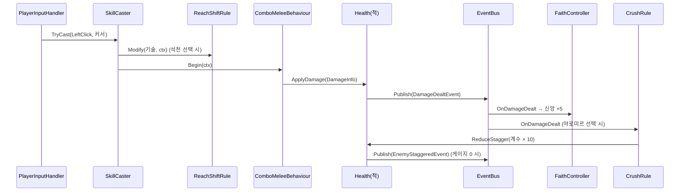

- 설계안 기준 흐름. 현재 구현은 `PlayerController` → `BasicAttack` 직접 실행이며 `EventBus` 미도입 (14.4). 신앙 자원 구현 시 이 흐름으로 갱신

### 14.2 격 돌파 (범인 → 초인)

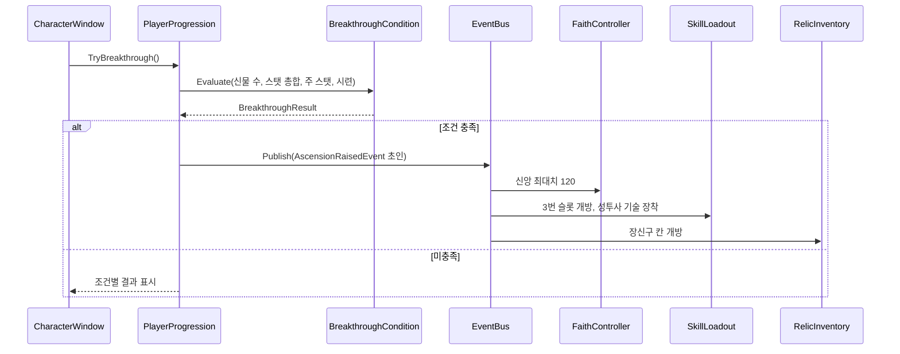

- 2차 직업 선택: 프로토타입은 성투사 고정. 초인 돌파 시 자동 전직 (선택 화면 생략, 확인 필요 15장 8번)

### 14.3 적 클릭 → 추적 → 자동 공격 (교전, 구현 완료)

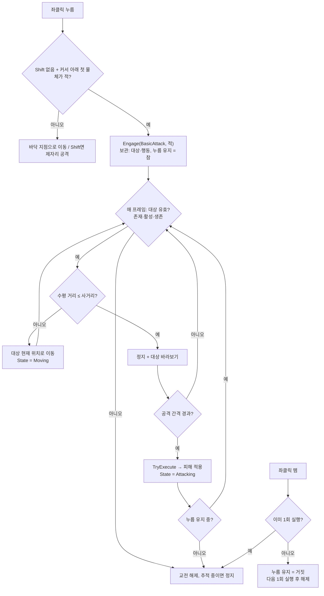

- 해제 조건 추가: 바닥 이동, Shift 제자리 공격, 우클릭 시전, 회피 성공
- 교전 시작(`Engage`) 시 대상 선택(`CurrentTarget`) 동시 갱신. 교전 해제와 무관하게 선택 유지 (4장)
- 누르고 있는 중 대상이 사라지면 `PlayerInputHandler`가 커서 방향 이동으로 전환

### 14.4 기본 공격 피해 적용 (구현 완료)

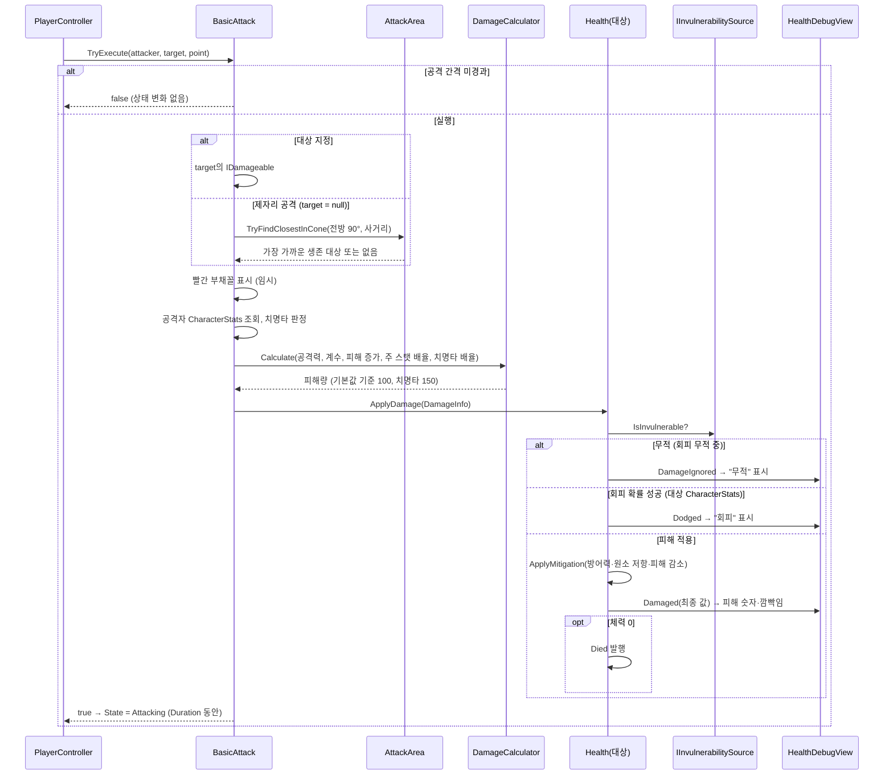

- `Died` 구독: 플레이어 → `PlayerController`가 `Dead` 상태 전환·입력 차단 / 테스트 적 → `TestDummyRespawner`가 숨김 후 3초 뒤 `RestoreFull`

## 15. 확인 필요

### 확정 (2026-10-02)

| 항목 | 결정 |
|---|---|
| `JobDefinition` 폴더 위치 | `Scripts/Ascension/`·`Data/Ascension/` 배치 (격 돌파와 전직이 함께 일어나는 구조) |
| 시전 전 수치 변경 연결 지점 | `ISkillParameterModifier` 도입. 이벤트 연결 원칙의 예외로 GDD 12장 반영 |
| 클릭 이동 방식 | `NavMeshAgent` 사용. AI Navigation 패키지(`com.unity.ai.navigation`) 설치 완료 |
| 이벤트 폴더 | `Scripts/Core/Events/` 하위 폴더 신설. FolderRules 반영 |

### 미결정

| 번호 | 항목 | 제안 |
|---|---|---|
| 4 | 보스 보호막 | `Health`에 보호막 값 추가 (피해가 보호막부터 차감) |
| 5 | 군주의 유물 칸 | 프로토타입은 빈 칸 표시만 |
| 6 | 기술 에셋 영어 이름 (6.2 표) | 제안안 사용, 구현 시 NamingRules 예시와 일치 확인 |
| 7 | 저장·불러오기 | 프로토타입 제외 |
| 8 | 2차 직업 선택 화면 | 프로토타입은 성투사 자동 전직 |
| 9 | 기본 공격과 `SkillCaster` 통합 | LeftClick 슬롯 기술이 `ITargetedAction`을 구현하고 `PlayerController.Engage`로 실행 (교전 흐름 재사용) |

- 번호: 본문 참조용으로 기존 번호 유지

## 16. 테스트 대상 (EditMode)

| 클래스 | 주요 검증 |
|---|---|
| `DamageCalculator` | 계수·피해 증가·피해 감소 계산, 감소율 상한, 주 스탯·치명타 배율, 감소 적용 (구현 완료: `DamageCalculatorTests`, 6건) |
| `StatSheet` | Flat·Percent·Multiplicative 합산, 출처 추가·제거, 1차 스탯 변환, 상한, 주 스탯 배율, 감소 곱셈 쌓기 (구현 완료: `StatSheetTests`, 11건) |
| `StatFormula` | 수렴식, 방어력 감소율 상한, 저항 상한, 곱셈 쌓기, 치명타 판정 경계값 (구현 완료: `StatFormulaTests`, 7건) |
| `CharacterStatsData` | 모든 `StatType` 필드 존재, `StatSheet` 기본값 기록 (구현 완료: `CharacterStatsDataTests`, 2건) |
| `BreakthroughCondition` | 4개 조건 각각 미충족, 주 스탯 40% 올림 경계값 (예: 총합 92 → 37) |
| `FaithModel` | 적중·피격 충전, 최대치 초과 방지, 비전투 감소, 격별 최대치, 충만 강화 비율 |
| `SkillLoadout` | 미해금 기술 장착 거부, 교체 후 슬롯 레벨 유지, 기술별 분기 저장, 전투 중 분기 변경 거부 |
| `StatAllocation` | 미분배 포인트 0일 때 분배 거부, 총합 계산 |
| `RelicInventory` | 미개방 칸 장착 거부, 무기 칸 성물 전용, 보유 수와 장착 수 구분, 신화 세트 판정 |
| `CombatStateTracker` | 마지막 행동 후 경과 시간 기준 비전투 전환 |
| `HarvestBuffTable` | 흡수 수 0~3 누적 강화 |
| `StaggerGauge` | 감소·0 도달 시 무력화, 3초 후 회복 시작, 무력화 후 저항 시간 동안 감소 무시 |
| `CooldownTracker` | 재사용 대기 경과 판정 |
